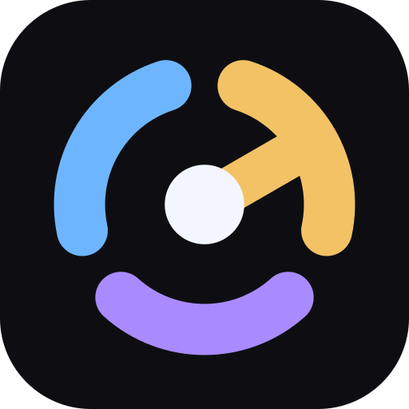

  

<h1 align="center">Ergon</h1>

  Automatic HoYoLAB check-ins, gift codes and web events for Genshin Impact, Honkai: Star Rail, 
  Zenless Zone Zero, Honkai Impact 3rd and Tears of Themis.

  
  
  

## Features

- **Daily check-in** for all five games, once a day, right after the reset.
- **Gift codes** found and redeemed automatically (Genshin, Star Rail, Zenless).
- **Web events:** the Machine Workshop (Genshin) and Traveling Mimo (Star Rail, Zenless). Ergon collects the
  daily and weekly points for you.
- **Auto exchange:** spends event points on the rewards you want, in your order of priority.
- **Prize draw** (Traveling Mimo): optionally spends spare points on the daily draws.
- **Per-game control:** every game has its own Configure screen, so you choose exactly what Ergon does for it.
- **Runs in the background** and tells you what it claimed, or when a sign-in expired.

### What each game supports

| Game | Check-in | Gift codes | Web event | Auto exchange | Prize draw |
| --- | :---: | :---: | --- | :---: | :---: |
| Genshin Impact | ✔ | ✔ | Machine Workshop | ✔ | — |
| Honkai: Star Rail | ✔ | ✔ | Traveling Mimo | ✔ | ✔ |
| Zenless Zone Zero | ✔ | ✔ | Traveling Mimo | ✔ | ✔ |
| Honkai Impact 3rd | ✔ | — | — | — | — |
| Tears of Themis | ✔ | — | — | — | — |

## Install

1. Download `ergon.apk` from the [latest release](https://github.com/mineygg/ergon/releases/latest) and install it.
   Android will ask you to allow installs from your browser or file manager the first time.
2. Open Ergon, accept the notice, and sign in to HoYoLAB. Google sign-in works. For gift codes, finish the
   second sign-in step on the Home screen.
3. Allow notifications so you hear about claims and expired sign-ins.
4. Open **Settings → Games → Configure** to pick what Ergon does for each game.
5. In Settings, tap **Allow** under *Unrestricted battery usage* so Android doesn't delay the background runs.

It runs on its own from there.

**Requirements:** Android 8.0 or newer, an internet connection, and a HoYoLAB account linked to your games.

---

## More details

**Configure (per game)**
- Settings lists every game with a **Configure** button. For each game you can switch the daily check-in,
  gift codes and the web event on or off. Only what a game supports is shown: Honkai Impact 3rd and Tears of
  Themis only have the check-in.
- When a game's web event is on, **Auto exchange** and **Exchange priority** appear there too.

**Schedule**
- Check-in runs once a day, 30 minutes after the daily reset (00:30 UTC+8). Games already claimed that day
  are never requested again.
- Gift codes are checked every hour and fully re-scanned every 6 hours.
- The web events run 30 minutes after each reset, 15 minutes before each reset and every 6 hours. Community
  missions reset at 00:00 UTC+8 and game missions at 04:00 server time. One run handles the games one after
  the other.

**Sign-in and privacy**
- Sign-in happens in an in-app browser. Ergon keeps only the HoYoLAB cookies it needs, stored encrypted on
  the device, and sends them only to HoYoverse servers.
- Gift codes need the second sign-in step, which provides a separate cookie for the redeem page.
- A redeem request is sent at least once a day, even with no new codes, so that cookie doesn't expire.
- If a session expires you get a notification, and you sign in again from the app.

**Machine Workshop and Traveling Mimo**
- Genshin has the Machine Workshop, Star Rail and Zenless have Traveling Mimo. All three work the same way and
  each has its own card on the Home screen, its own on/off switch and its own auto exchange settings.
- Each task gets one attempt to be completed through the API per day or week. If the server refuses
  (for example it needs in-game play), the task is only watched, and claimed once its progress is complete.
- Tasks already claimed are skipped.
- **Auto exchange** (off by default, per game): after the tasks, the exchange shop is read once per run.
  Rewards that cost 0 are always claimed. Then the rewards in that game's **Exchange priority** list are claimed
  top to bottom. If the top reward costs more than you have, the mode decides: *Wait for points* keeps
  saving, *Claim what I can afford* moves on to the next affordable one.
- **Prize draw** (Star Rail and Zenless): in the exchange priority screen, *Prize draw only* claims nothing and
  spends the points on draws. *Draw when nothing is left to claim* (with either of the other two modes) draws once
  no reward in the list is left to claim, never while you are saving for one. The server allows 5 draws per game
  per day, and Ergon never goes past that. Genshin's prize draw is left to you.
- If a reward or prize is delivered as a redeem code, Ergon redeems it for you through the gift-code API (needs the second
  sign-in step). Without it, the code is shown in Activity and in the notification.
- Claimed rewards are hidden. Timed rewards (on a refresh timer) are listed but not claimable until they
  refresh; they have no timer of their own and are only checked on the normal runs.
- Every claim request is sent at least 5 seconds after the previous one, across all games.

**Other**
- Background runs use Android's WorkManager, so they happen even when the app is closed. Nothing runs in
  between, and there is no always-on service. Phones with strict battery saving may delay the runs, which is
  what the *Unrestricted battery usage* button in Settings is for.
- Ergon checks GitHub for new releases and offers an **Update** button. The check can be turned off in
  Settings. Updates only install over a build signed with the same key.
- Runs can be started or stopped manually from each card on the Home screen.
- Each screen keeps its scroll position when you switch tabs or open a Configure screen.

**Disclaimer**
Unofficial fan project, not affiliated with or endorsed by HoYoverse. Automating accounts is your own call
and at your own risk.

**Development**
See [BUILDING.md](BUILDING.md).

**Name, icon and identifiers**
The name "Ergon", the app icon (`assets/icon.svg` and the launcher icon files in the app), the name "mineygg" and
the application ID and package names `com.mineygg.ergon` (`applicationId` and `namespace` in
`app/build.gradle.kts`, and the Kotlin source packages) are **not** covered by the GPL v3, and no rights to use
them are granted. If you fork or modify Ergon, remove them and use your own name, icon, application ID and
package names, and don't suggest your version comes from or is endorsed by the original author.
The copyright notice and the link to this project must stay, as `NOTICE` requires. The source code itself stays
under the GPL v3.

**License**
Copyright (C) 2026 mineygg. GNU General Public License v3.0 (see `LICENSE`), with the attribution terms in `NOTICE`.
The name, icon and identifiers are excluded, as described above.
